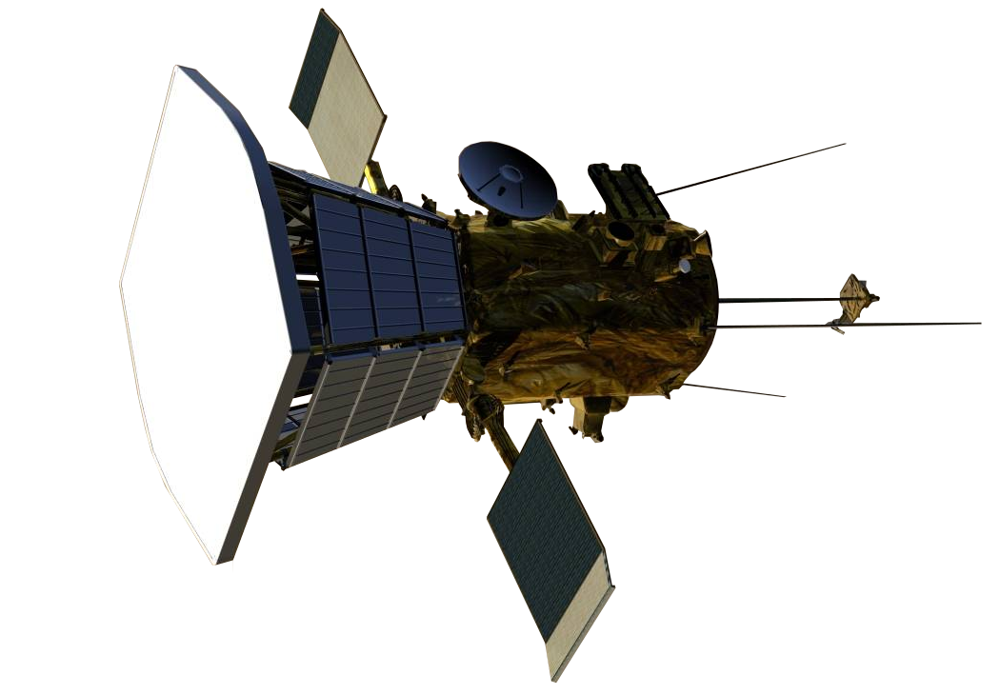
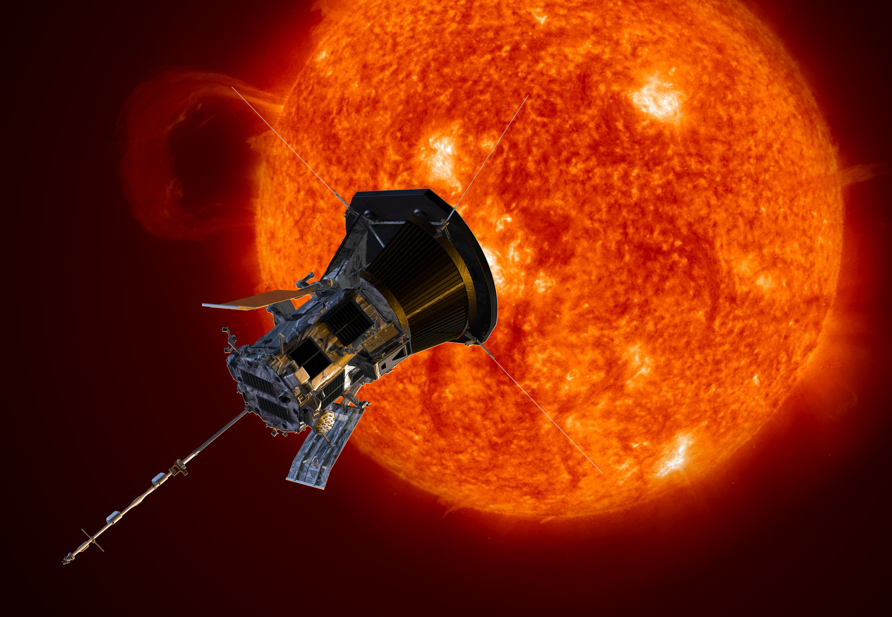

# Parker Solar Probe — 3D Mission & Thermodynamic Analysis Dashboard

[](https://react.dev/)
[](https://threejs.org/)
[](https://docs.pmnd.rs/react-three-fiber/)
[](https://tailwindcss.com/)
[](https://katex.org/)
[](LICENSE)

*Español: Puedes leer la versión completa en español en [README.es.md](README.es.md).*

---

## 🛰 Overview

A state-of-the-art (SOTA) interactive 3D WebGL dashboard built with **React**, **Three.js / React Three Fiber**, **Tailwind CSS**, and **KaTeX**. Designed for aerospace engineers, astrophysicists, and researchers, this project provides a deep scientific exploration of NASA's historic **Parker Solar Probe** mission — humanity's first spacecraft to fly through the solar corona at **8.86 solar radii** ($0.041\text{ AU} \approx 6.16\times 10^6\text{ km}$) and reach a record heliocentric velocity of **$192\text{ km/s}$** ($430{,}000\text{ mph}$).

| Spacecraft 3D CAD Model | Solar Plasma Streamers |
|:---:|:---:|
|  |  |

---

## 🌟 Key Features

### 1. Multi-Layer 3D Split-in-Half Sun (CFD Colormaps)
- **Cutaway Hemispheric View**: A $110^\circ$ wedge slice revealing all concentric internal and atmospheric layers:
  1. **Core** ($1.5\times 10^7\text{ K}$, $150\text{ g/cm}^3$, $p$-$p$ chain fusion)
  2. **Radiative Zone** ($7\times 10^6 \rightarrow 2\times 10^6\text{ K}$, photon diffusion)
  3. **Convective Zone** ($2\times 10^6 \rightarrow 6{,}500\text{ K}$, magnetic buoyancy cells)
  4. **Photosphere** ($6{,}200^\circ\text{C}$ base $\rightarrow 3{,}700^\circ\text{C}$ top)
  5. **Chromosphere** ($4{,}000 \rightarrow 20{,}000\text{ K}$, $\text{H}\alpha$ line emission)
  6. **Transition Region** ($20{,}000 \rightarrow 500{,}000\text{ K}$ steep gradient)
  7. **Corona** ($>1{,}000{,}000\text{ K}$, $\text{Kn} \gg 10$)
- **Live CFD Field Switcher**:
  - `Natural`: Plasma emission with procedural granulation GLSL shaders and coronal magnetic loops.
  - `CFD T(r)`: Kinetic temperature scale with an Inferno colormap ($30^\circ\text{C} \rightarrow 1.5\times 10^7\text{ K}$).
  - `CFD |q|`: Heat flux magnitude showing $q_{\text{rad}} \propto 1/r^2$ ($63\text{ MW/m}^2$ at surface vs. $650\text{ kW/m}^2$ at perihelion) vs. rarefied convective coronal flux ($q_{\text{conv}} \approx 0.02\text{ W/m}^2$).

### 2. High-Fidelity 3D Spacecraft Hardware
- **Thermal Protection System (TPS)**: $11.4\text{ cm}$ sandwich composed of white $\text{Al}_2\text{O}_3$ ceramic paint ($\alpha_s = 0.18$, $\varepsilon = 0.86$), front and rear $2\text{ mm}$ Carbon-Carbon (C-C) facesheets, and a $97\%$ porous open-cell Ultramet carbon foam core.
- **Solar Probe Cup (SPC)**: True quadricular ($100\,\mu\text{m}$) acid-etched Tungsten ($W$) modulator grid, sapphire insulation rings, and Niobium C-103 collector plate, positioned in the boundary shadow.
- **Coaxial Refractory Cable Harness**: 3D coaxial cable and exploded cross-section showing inner Niobium C-103 core ($2{,}350^\circ\text{C}$ melt), monocrystalline sapphire sleeves ($2{,}040^\circ\text{C}$ melt), and outer Nb C-103 jacket.
- **Articulated Solar Array Wings & Active $\text{H}_2\text{O}$ Cooling**:
  - Animated wing sweep ($10^\circ \rightarrow 82^\circ$) inside the Umbra shadow cone.
  - Interactive angle slider with real-time electrical power ($W$) and cell temperature ($^\circ\text{C}$) readout.
  - Coolant particles circulating through titanium channels into 4 pyramidal graphite radiators ($\varepsilon = 0.92$).
- **Solar Limb Optical Lens Sensors**: $4$ periscopic optical sensors with forward-facing ($+Z$) quartz/sapphire convex lenses and photodiode detectors feeding autonomous attitude control software (ACSW).
- **Perpendicular Incident Solar Radiation Rays**: Toggleable animated photon pulse vectors striking the TPS at $650\text{ kW/m}^2$ and reflecting $82\%$.


### 3. Keplerian Trajectory & 7 Venus Gravity Assists
- Elliptical transfer model depicting perihelion drop from $1.00\text{ AU}$ ($150\times 10^6\text{ km}$) to $0.041\text{ AU}$ ($6.16\times 10^6\text{ km}$).
- $7$ interactive Venus flyby waypoints displaying accumulated $\Delta v$ shedding and orbital energy dissipation.
- Vis-viva velocity indicator ($17\text{ km/s}$ at aphelion $\rightarrow 192\text{ km/s}$ at perihelion).

### 4. 3D Atomic & Microstructural Material Analysis Scene
- $sp^2$ Hexagonal Carbon-Carbon / Graphene crystal lattice.
- $97\%$ Porous open-cell Ultramet carbon foam ligament cage demonstrating Rosseland infrared radiation scattering.
- Coaxial Niobium C-103 + Sapphire ($\alpha\text{-Al}_2\text{O}_3$) atomic and cylindrical cutaway.
- Micro-scale $100\,\mu\text{m}$ quadricular Tungsten ($W$) grid model.

### 5. Interactive Technical Modals & Video Center
- **Blueprint Modal**: 5 high-resolution engineering schematics and charts from mission archives.
- **Video & Report Modal**: Direct embeds and links for:
  - *How NASA's Parker Solar Probe Will Survive the Sun* (NASA Goddard)
  - *The Insane Engineering of the Parker Solar Probe* (Real Engineering)
  - Direct access to the comprehensive technical report on [Google Drive / Docs](https://docs.google.com/document/d/1b7eNMyO5pENDptTPzfeo3wBvgB3_d09c/edit?usp=sharing&ouid=102220368577968794134&rtpof=true&sd=true).
- **Full Bilingual Support**: Instant 1-click toggle (`EN / ES`) across every UI label, equation derivation, 3D tooltip, and transcript.

---

## 📐 Heat Transfer & Orbital Mechanics Formulations

All formulations are rendered with native **KaTeX LaTeX**:

1. **TPS Surface Radiative Equilibrium**:
   $$\alpha_s \cdot \frac{S_0}{(r / 1\,\text{AU})^2} \cos\theta = \varepsilon \sigma T_s^4 + q_{\text{cond}}$$
2. **Fourier Conduction & Rosseland Radiative Conductivity in Ultramet Foam**:
   $$q_{\text{cond}} = -k_{\text{eff}}(T)\frac{dT}{dx}, \quad k_{\text{eff}}(T) = k_{\text{solid}} + \frac{16 n^2 \sigma T^3}{3 \beta_R}$$
3. **Active Liquid Water Cooling & Radiative Rejection**:
   $$\dot{Q} = \dot{m} C_p (T_{\text{out}} - T_{\text{in}}) = \varepsilon_{\text{rad}} A_{\text{rad}} \sigma (T_{\text{rad}}^4 - T_\infty^4)$$
4. **Rarefied Coronal Convective Flux (Knudsen Free-Molecular Flow, $\text{Kn} \gg 10$)**:
   $$\text{Kn} = \frac{\lambda_{\text{mfp}}}{L} \gg 10 \implies q_{\text{conv}} = \frac{\alpha_{\text{acc}}}{2} n_p m_p v_{\text{th}}^3 \approx 0.02\,\text{W/m}^2 \ll q_{\text{rad}}$$
5. **Hohmann Transfer $\Delta v$ Budget**:
   $$\Delta v_1 = \sqrt{\frac{\mu_\odot}{r_1}} \left(1 - \sqrt{\frac{2 r_2}{r_1 + r_2}}\right) = 21.4\,\text{km/s}$$
6. **Vis-Viva Orbital Speed**:
   $$v^2 = \mu_\odot \left(\frac{2}{r} - \frac{1}{a}\right) \implies v_{\text{perihelion}} = 192\,\text{km/s}$$

---

## 🗂 Project Directory Structure

```text
├── docs/
│   ├── images/              # Blueprints, NASA emblem, and spacecraft reference renders
│   └── transcripts/         # Original mission scripts and transcripts
├── public/
│   ├── blueprints/          # Assets served for blueprint modals
│   ├── images/              # Assets served for 3D textures and HUD
│   ├── nasa-6.png           # NASA header emblem
│   └── Parker_Solar_Probe_Informe_Ingenieria_PhD.docx
├── src/
│   ├── components/          # UI panels, HUD bars, modals, KaTeX wrapper
│   ├── i18n/                # Complete English and Spanish dictionaries & specs
│   └── scene/               # Three.js / React Three Fiber 3D components
├── README.md                # English Documentation (Default)
├── README.es.md             # Documentación Completa en Español
└── package.json
```

---

## 🚀 Getting Started

### Prerequisites
- **Node.js**: v18.0.0 or higher
- **npm**: v9.0.0 or higher

### Installation & Run

```bash
# Clone the repository
git clone https://github.com/0xrphl/parker-solar-probe-mission-3D-dashboard-analysis.git
cd parker-solar-probe-mission-3D-dashboard-analysis

# Install dependencies
npm install

# Start development server
npm run dev
```

Open your browser at `http://localhost:3000`.

### Production Build

```bash
npm run build
npm run preview
```

---

## 📚 References & Bibliography

- **Incropera, F. P., DeWitt, D. P., Bergman, T. L., & Lavine, A. S. (2017).** *Fundamentals of Heat and Mass Transfer* (8th ed.). John Wiley & Sons.
- **NASA Goddard Space Flight Center (2018).** *How NASA's Parker Solar Probe Will Survive the Sun*. [YouTube](https://www.youtube.com/watch?v=RT9laVHZZQo).
- **Real Engineering (2022).** *The Insane Engineering of the Parker Solar Probe*. [YouTube](https://www.youtube.com/watch?v=pOZhPz92Dic).
- **Fox, N. J., et al. (2016).** "The Solar Probe Plus Mission: Humanity's First Visit to Our Star." *Space Science Reviews*, 204(1–4), 7–48.
- **Congdon, E., et al. (2018).** "Solar Probe Plus Thermal Protection System (TPS) Design, Material Characterization, and Qualification." *Johns Hopkins APL Technical Digest*.
- **Case, A. W., et al. (2020).** "The Solar Probe Cup on the Parker Solar Probe." *The Astrophysical Journal Supplement Series*, 246(2), 43.

---

## 📄 License

This project is licensed under the MIT License.
